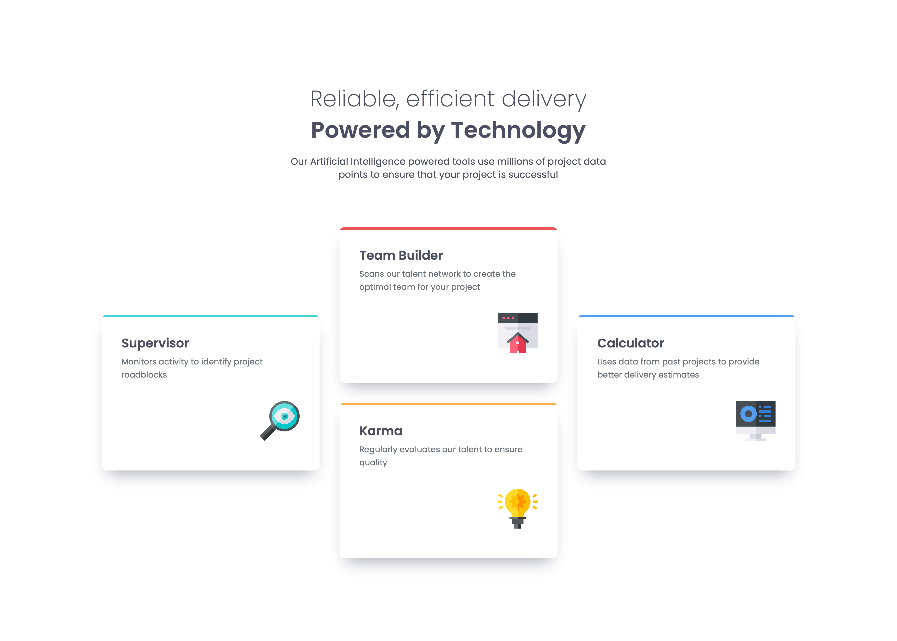
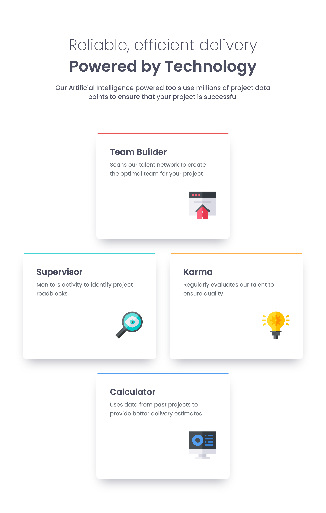
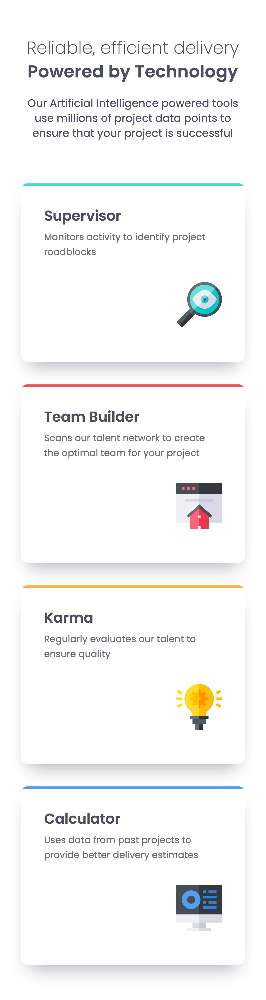

# Frontend Mentor - Four card feature section solution

This is a solution to the [Four card feature section challenge on Frontend Mentor](https://www.frontendmentor.io/challenges/four-card-feature-section-weK1eFYK). Frontend Mentor challenges help you improve your coding skills by building realistic projects.

## Table of contents

- [Overview](#overview)
  - [The challenge](#the-challenge)
  - [Screenshot](#screenshot)
  - [Links](#links)
- [My process](#my-process)
  - [Built with](#built-with)
  - [What I learned](#what-i-learned)
  - [Continued development](#continued-development)
  - [Useful resources](#useful-resources)
  - [AI Collaboration](#ai-collaboration)
- [Author](#author)
- [Acknowledgments](#acknowledgments)

## Overview

### The challenge

Users should be able to:

- View the optimal layout for the site depending on their device's screen size

I built the page mobile-first with two breakpoints. On small screens the four cards are in one column. From 768px they are in a grid of two columns, with the first and the last card in the center. From 1440px there are three columns, and the two cards in the middle column are placed one under the other.

### Screenshot

### Links

- Solution URL: [Four card feature section source](https://github.com/QusBee/practice/tree/main/frontend-mentor/feature-section)
- Live Site URL: [Four card feature section](https://qusbee.github.io/practice/frontend-mentor/feature-section/)

## My process

### Built with

- Semantic HTML5 markup
- CSS custom properties
- Flexbox
- CSS Grid with `grid-template-areas`
- BEM class naming
- Google Fonts (Poppins)
- Mobile-first workflow with two breakpoints (768px and 1440px)

### What I learned

**`justify-content` works only on the children of its own container.** I set `justify-content: center` on the `body`, but the header was not centered. It centers only the direct child (`main`), and only along the main axis. The header is a child of `main`, and `main` is a column, so for the horizontal center I needed `align-items`. Before I change an alignment property, I now check which element is the container and which direction the main axis has.

**A line break inside a heading without ` `.** To move the second part of the title to a new line, I put it in a `span` and set `display: block`. The space before the `span` is ignored in this case. Also, the break can be removed in a media query if needed.

**Measure the free space in the design, not only the sizes.** In Figma the cards are 250px high, and the elements inside are placed from the top: text at 32px, icon at 139px. In my CSS the card was 235px, because the content needs only that. The missing 15px are free space under the icon. I used `min-height` with a normal `padding: 3.2rem`, because the icon follows the text from the top. A bigger `padding-bottom` also gives 250px, but it is a magic number that stays even when the text becomes longer.

**Grid on a `ul`.** The `ul` can be a grid container, and the `li` elements are the grid items. With `grid-template-areas` I changed the layout only in CSS, without touching the HTML, and the reading order stays the same. The area names must match the content of the card, otherwise it is easy to make a mistake when the layout changes.

**The width of a card came from its content.** On desktop my cards were 314px wide, but the design has 350px. The width of a grid item with `justify-self: center` and in a fit-to-content list depends on the content, here on the `max-width` of the text block. I changed the `max-width` of `card__header` (250px + 2 × 32px of padding = 314px, 286px + 64px = 350px), and the text wraps in the same places as in the design. I should make such widths explicit in the next projects.

**Safari shows 1439px instead of 1440px.** In the Responsive Design mode, Safari scales the page (for example, 61%) and rounds the width, so `min-width: 1440px` does not work and the tablet layout stays. The CSS was correct. Setting 1441px or 100% scale proves it.

### Continued development

- Practise tables separately with a series of small exercises.
- Make widths explicit in grid layouts, so they do not depend on the content.
- Check the layout at every width, especially just below and just above the breakpoints.
- Learn to write good commit messages in English.

### Useful resources

- [MDN - grid-template-areas](https://developer.mozilla.org/en-US/docs/Web/CSS/grid-template-areas) - Naming the areas of a grid.
- [MDN - Aligning items in a flex container](https://developer.mozilla.org/en-US/docs/Web/CSS/CSS_flexible_box_layout/Aligning_items_in_a_flex_container) - Main axis and cross axis, `justify-content` and `align-items`.
- [MDN - min-height](https://developer.mozilla.org/en-US/docs/Web/CSS/min-height) - A minimum height that can grow with the content.

### AI Collaboration

I used Claude as a mentor and reviewer, not as a code generator.

- **How I used it:** I wrote all the HTML and CSS myself. Claude checked each stage (HTML, mobile, tablet, desktop) and pointed out problems: the area names that did not match the cards, the `;;` typo, `display: flex` on an `img`, and the card width that was 314px instead of 350px. It also helped me understand why `justify-content` did not center the header, and why the card was 235px instead of 250px.
- **What worked well:** Short hints with the reason, and then I find the fix myself. Checking the final result again after each fix, also in the browser at the real breakpoint widths.
- **What I'd do differently:** Open the design and write down the distances between the elements before I start the CSS, not after I see a difference.

## Author

- Frontend Mentor - [@QusBee](https://www.frontendmentor.io/profile/Qusbee)
- GitHub - [@QusBee](https://github.com/Qusbee)

## Acknowledgments

Thanks to the Frontend Mentor team for the design files and the challenge brief.
