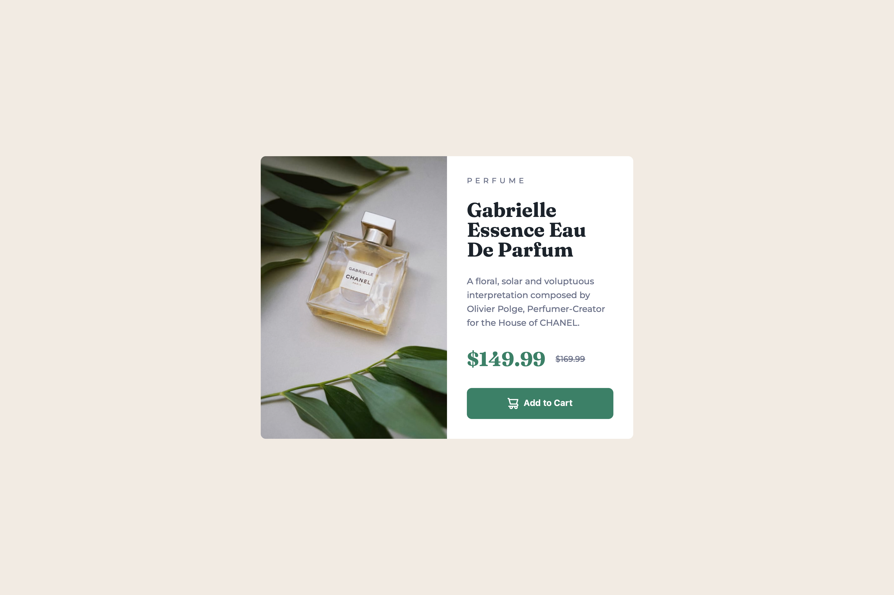
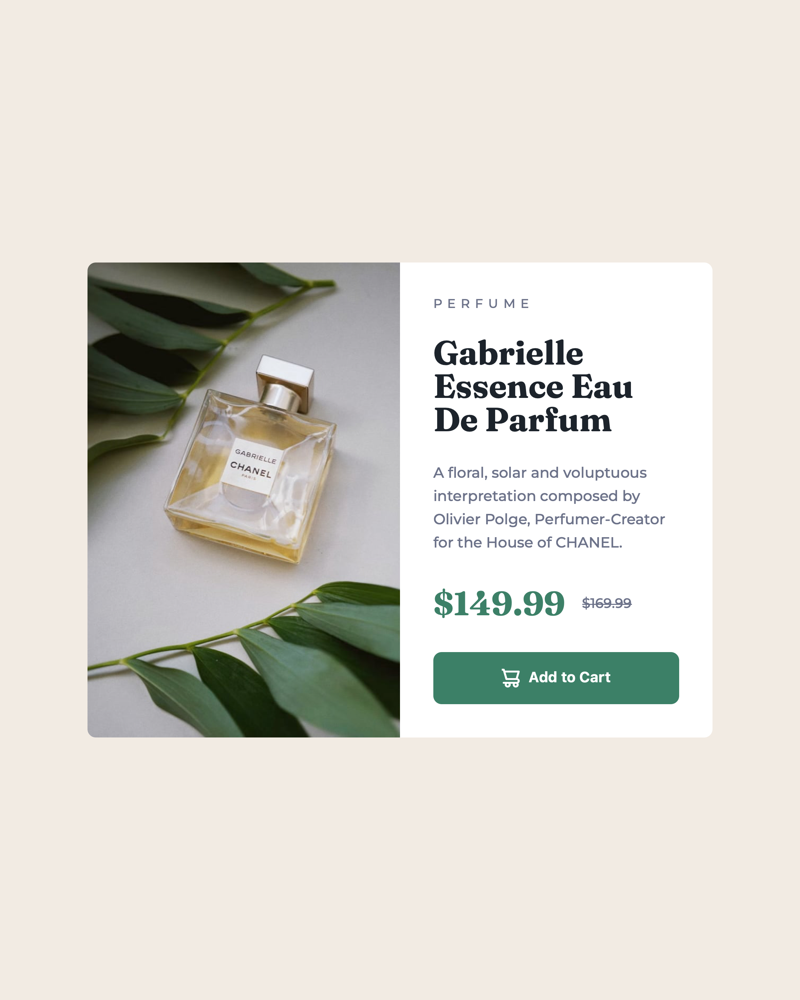
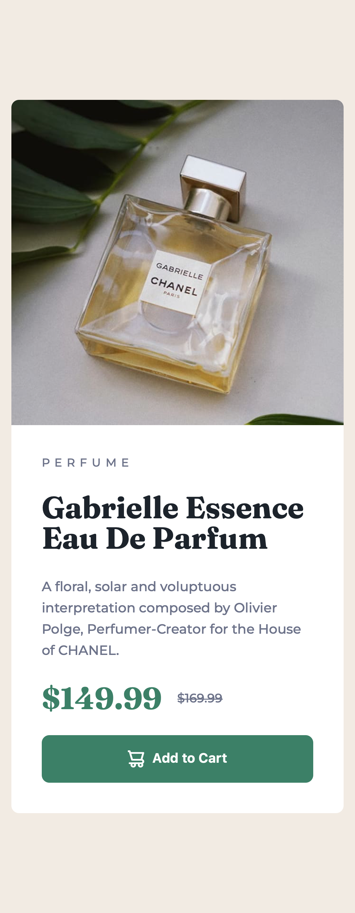

# Frontend Mentor - Product preview card component solution

This is a solution to the [Product preview card component challenge on Frontend Mentor](https://www.frontendmentor.io/challenges/product-preview-card-component-GO7UmttRfa). Frontend Mentor challenges help you improve your coding skills by building realistic projects.

## Table of contents

- [Overview](#overview)
  - [The challenge](#the-challenge)
  - [Screenshot](#screenshot)
  - [Links](#links)
- [My process](#my-process)
  - [Built with](#built-with)
  - [What I learned](#what-i-learned)
  - [Continued development](#continued-development)
  - [Useful resources](#useful-resources)
  - [AI Collaboration](#ai-collaboration)
- [Author](#author)
- [Acknowledgments](#acknowledgments)

## Overview

### The challenge

Users should be able to:

- View the optimal layout depending on their device's screen size
- See hover and focus states for interactive elements

I built the card to match the design as closely as possible. On small screens the image is on top of the text. From 768px the card becomes a row, and the image and the text take exactly half of the card each.

### Screenshot





### Links

- Solution URL: [Product preview card source](https://github.com/QusBee/practice/tree/main/frontend-mentor/preview-card)
- Live Site URL: [Product preview card](https://qusbee.github.io/practice/frontend-mentor/preview-card/)

## My process

### Built with

- Semantic HTML5 markup
- `picture` and `source` for a different image on desktop
- CSS custom properties
- Flexbox
- BEM class naming
- Google Fonts (Fraunces and Montserrat)
- Mobile-first workflow with one breakpoint (768px)

### What I learned

**`flex: 1` does not always give equal halves.** I gave the image and the text the same `flex: 1`, but the widths were different. The text block has `padding`, and the image has none, so the two items started from different sizes. The free space was shared equally, but the start was not equal. Setting the same start width for both fixes it. Because of `box-sizing: border-box`, 50% includes the padding:

```css
.card__picture {
  flex-basis: 50%;
}

.card__content {
  flex: 1 1 50%;
}
```

**One breakpoint in two places.** The `source` in the HTML and the media query in the CSS must use the same width (768px). When they were different, the desktop image was loaded while the layout was still a column, and the card became very tall.

**The `height` attribute is a CSS height.** The `height="684"` in the HTML stays as a fixed height even when the width gets smaller, and the image stretches. `height: auto` keeps the proportions. `object-fit: cover` is useful only when both sizes are fixed, so I use it on desktop with `height: 100%`. I also put `width` and `height` on the `source`, because the desktop image has other proportions than the mobile one.

**An `img` is inline, again.** The white line under the image came back, now inside `picture`. `display: block` on the `img` removed it.

**Hiding text for screen readers.** `display: none` hides the text from screen readers too. `aria-label` on a `span` or `del` is not reliable. I used a `visually-hidden` class, so the words "Current price" and "Original price" are not seen, but they are read aloud:

```css
.visually-hidden {
  position: absolute;
  width: 0.1rem;
  height: 0.1rem;
  padding: 0;
  margin: -0.1rem;
  overflow: hidden;
  clip: rect(0, 0, 0, 0);
  white-space: nowrap;
  border: 0;
}
```

**Measuring against Figma.** Figma shows a line height of 160%, but it draws every line as a whole number: 22px, not 22.4px. Four lines are 88px in Figma and 89.6px in the browser. I kept the relative `line-height`, because the 1.6px difference does not matter. The real difference of 6px in the card height came from the `gap` between the elements, not from the heights of the elements. Now I measure the distances between elements as well (hold `Option` in Figma).

### Continued development

- Practise tables separately with a series of small exercises.
- Check the layout at every width, especially between the breakpoints, not only at the design widths.
- Learn to write good `alt` texts in English.
- Get more comfortable with measuring layouts in DevTools and in Figma.

### Useful resources

- [MDN - picture](https://developer.mozilla.org/en-US/docs/Web/HTML/Element/picture) - How to load a different image for a different screen.
- [MDN - flex-basis](https://developer.mozilla.org/en-US/docs/Web/CSS/flex-basis) - The start size of a flex item.
- [MDN - object-fit](https://developer.mozilla.org/en-US/docs/Web/CSS/object-fit) - Cropping an image to a fixed size.
- [WebAIM - Alternative text](https://webaim.org/techniques/alttext/) - How to write a useful `alt` text.
- [The A11Y Project - How to hide content](https://www.a11yproject.com/posts/how-to-hide-content/) - Hiding text visually but not for screen readers.

### AI Collaboration

I used Claude as a mentor and reviewer, not as a code generator.

- **How I used it:** I wrote all the HTML and CSS myself. Claude checked each stage and pointed out problems: typos in file paths and class names (`desctop`, `./image/`, `card__imege`), a description that repeated the title, the missing `width` and `height` on the `source`, the different breakpoints, and the wrong way to hide text. It also helped me find the cause when the widths of the two halves were not equal.
- **What worked well:** Short hints that explain the reason, and then I find the fix myself. Checking the final result again after each fix.
- **What I'd do differently:** Measure the distances between elements, not only the sizes of the elements, before asking about a difference with the design.

## Author

- Frontend Mentor - [@QusBee](https://www.frontendmentor.io/profile/Qusbee)
- GitHub - [@QusBee](https://github.com/Qusbee)

## Acknowledgments

Thanks to the Frontend Mentor team for the design files and the challenge brief.
