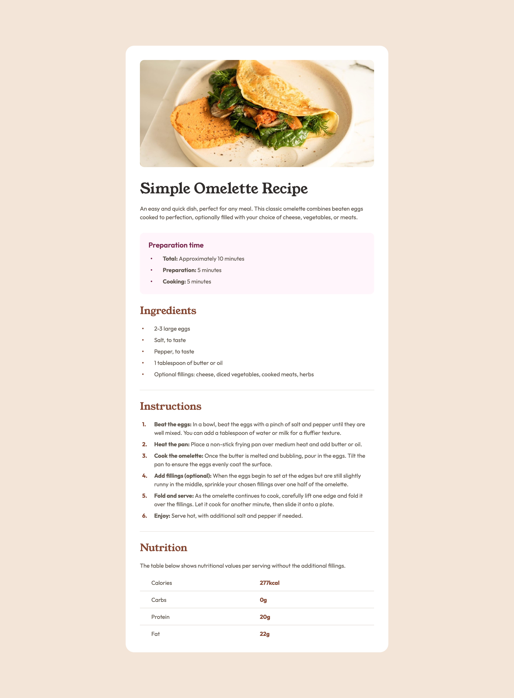
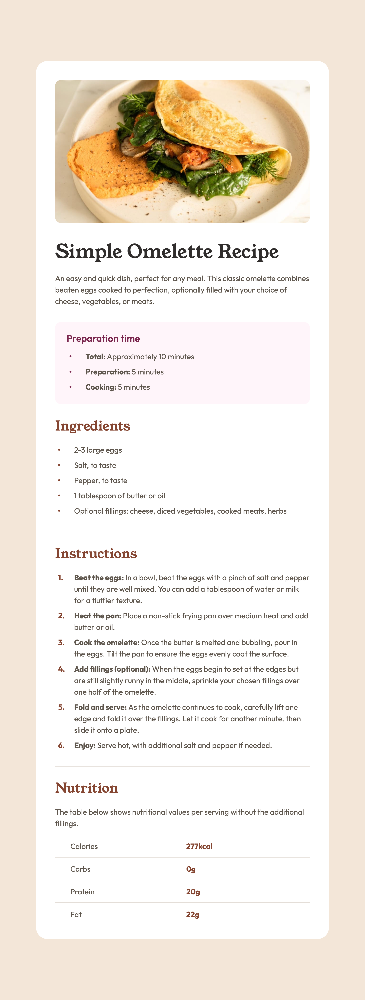
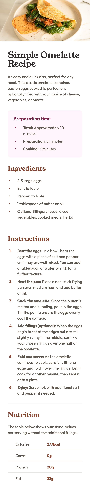

# Frontend Mentor - Recipe page solution

This is a solution to the [Recipe page challenge on Frontend Mentor](https://www.frontendmentor.io/challenges/recipe-page-KiTsR8QQKm). Frontend Mentor challenges help you improve your coding skills by building realistic projects.

## Table of contents

- [Overview](#overview)
  - [The challenge](#the-challenge)
  - [Screenshot](#screenshot)
  - [Links](#links)
- [My process](#my-process)
  - [Built with](#built-with)
  - [What I learned](#what-i-learned)
  - [Continued development](#continued-development)
  - [Useful resources](#useful-resources)
  - [AI Collaboration](#ai-collaboration)
- [Author](#author)
- [Acknowledgments](#acknowledgments)

## Overview

### The challenge

Build out the recipe page and get it looking as close to the design as possible. The page has three layouts: mobile, tablet and desktop.

### Screenshot





### Links

- Solution URL: [Recipe page source](https://github.com/QusBee/practice/tree/main/frontend-mentor/recipe-page)
- Live Site URL: [Recipe page](https://qusbee.github.io/practice/frontend-mentor/recipe-page/)

## My process

### Built with

- Semantic HTML5 markup
- CSS custom properties
- Flexbox
- BEM class naming
- CSS counters and pseudo-elements for custom list markers
- Self-hosted fonts with `@font-face`
- Mobile-first workflow with two breakpoints (768px and 1440px)

### What I learned

The most useful lessons came from things that looked fine at first but did not behave as I expected.

**BEM: a modifier is a small difference, not a different element.** The "Preparation time" heading differs from the other headings in font, size, weight and colour, so it is not a variant of `recipe__title`. The whole pink card is a separate block (`preparation`) with its own elements. The remaining headings share a base class, and only the `h1` gets a modifier named by its role (`recipe__title--main`), not by how it looks.

**Specificity and order.** My modifier for the pink list markers did nothing, because the base rule had a more specific selector (a tag, two classes and a pseudo-element). The modifier needs the same structure, and it must come after the base rule:

```css
ul.recipe__list > .recipe__item::before {
  background-color: var(--color-brown-800);
}

ul.recipe__list--accent > .recipe__item::before {
  background-color: var(--color-rose-800);
}
```

**A comma starts a new selector.** In a list of selectors, every part needs its full path. Writing `.row:first-child .name, .value` also matches every `.value` on the page. I made this mistake twice.

**Custom list markers.** I removed the default markers with `list-style: none` and drew them with `::before`. The dots use an absolutely positioned pseudo-element, and the numbers use CSS counters (`counter-reset` on the list, `counter-increment` on each item). The item needs `position: relative`, otherwise the marker is placed relative to a far-away ancestor. In Safari with VoiceOver, `list-style: none` removes the list semantics, so I added `role="list"` to every list.

**An `img` is an inline element.** The thin strip under the picture was the space the browser leaves below a line of text. `display: block` removed it. For the fixed 300px height on tablet and desktop I used `object-fit: cover`, so the image is cropped instead of stretched. The `width` and `height` attributes in the HTML stop the layout from jumping while the image loads.

**Tables are different from flex and grid.** A table has no `gap`, so the 16px gap between the two columns from Figma became 8px of padding on each side of the boundary. Equal columns come from `table-layout: fixed` with `width: 100%`. The 12px between rows in the design exists only between rows, so I removed the top padding of the first row and the bottom padding of the last one with `:first-child` and `:last-child`. The 1px row dividers take space in a table, so I subtracted 1px from the padding of the other rows with `:not(:last-child)`.

```css
.nutrition-table__row:not(:last-child) .nutrition-table__name,
.nutrition-table__row:not(:last-child) .nutrition-table__value {
  padding-bottom: 1.1rem;
}
```

**Lines in Figma take no space.** The two `hr` dividers added 2px to the card height. A zero-height element casts a zero-area shadow, so a `box-shadow` with a vertical offset alone drew nothing. A spread value gives the shadow an area, which makes a 1px line that does not affect the layout.

**Measuring.** A difference of 1px between two browsers in responsive mode was a measuring artifact, not a bug in my CSS. Checking in a second browser saved me from "fixing" correct code. Text can also wrap differently in different browsers when a line is almost the full width.

### Continued development

- Practise tables separately with a series of small exercises, because most of my problems in this project were with the table.
- Learn how to choose breakpoints from the content, not only from the design widths.
- Configure the HTML formatter so that the formatted markup is easier for me to read.
- Get more comfortable with measuring layouts in DevTools and in Figma.

### Useful resources

- [MDN - border-collapse](https://developer.mozilla.org/en-US/docs/Web/CSS/border-collapse) - How cell borders are merged and why row borders need it.
- [MDN - table-layout](https://developer.mozilla.org/en-US/docs/Web/CSS/table-layout) - Fixed layout gives equal column widths.
- [MDN - object-fit](https://developer.mozilla.org/en-US/docs/Web/CSS/object-fit) - Cropping an image to a fixed size.
- [MDN - box-shadow](https://developer.mozilla.org/en-US/docs/Web/CSS/box-shadow) - The offset, blur and spread values.
- [MDN - counter-increment](https://developer.mozilla.org/en-US/docs/Web/CSS/counter-increment) - How CSS counters work.
- [MDN - Specificity](https://developer.mozilla.org/en-US/docs/Web/CSS/Specificity) - Why a rule lower in the file can still lose.

### AI Collaboration

I used Claude as a mentor and reviewer, not as a code generator.

- **How I used it:** I wrote all the HTML and CSS myself. Claude reviewed each stage, measured the design files, and pointed out problems such as typos in attributes and variable names, selector specificity, the comma in selector lists, the zero-height divider and the extra padding in the table. It explained the options and I made the decisions (for example, making "Preparation" its own block).
- **What worked well:** Explaining the logic first and leaving the writing to me. It was easier to remember a concept when I had to find the fix myself.
- **What I'd do differently:** Look at the problem in DevTools and compare it with the design first, so I can find the cause myself before asking.

## Author

- Frontend Mentor - [@QusBee](https://www.frontendmentor.io/profile/Qusbee)
- GitHub - [@QusBee](https://github.com/Qusbee)

## Acknowledgments

Thanks to the Frontend Mentor team for the design files and the challenge brief.
